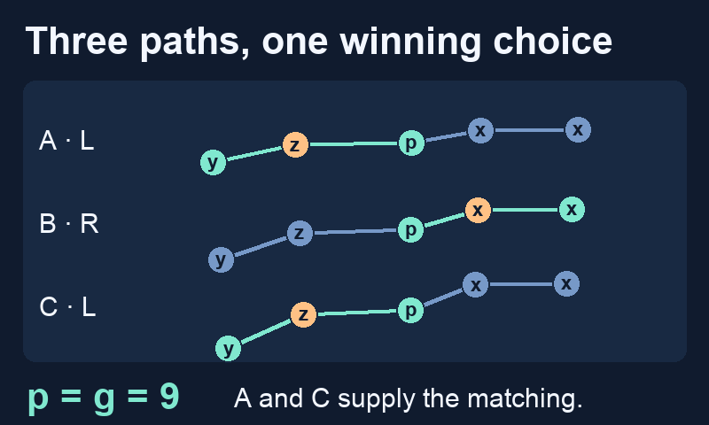

# Plurality voter control with full radius-two bundles

   

Deciding whether adding the bundles of at most k leaders makes a candidate a plurality co-winner is NP-complete when each bundle contains exactly the potential voters within two adjacent swaps of its leader and has at most three voters. The hardness holds when the distance graph is a disjoint union of induced five-vertex paths. This resolves Chen’s radius-two, size-three case.

[Read the paper](paper/manuscript.pdf) · [LaTeX source](paper/manuscript.tex) · [Original question, p. 149](https://depositonce.tu-berlin.de/bitstreams/01ad4a50-8834-4ecd-9607-88785af545eb/download#page=177) · [Catalog Q364](https://github.com/10m-u/open-problems-catalog/blob/ca8d4d44ba3db527f19f28928c240168f545ecfe/problems/game_theory/social-choice-voting-theory.md#q364) · [Version DOI](https://doi.org/10.5281/zenodo.24570446)

## Explore the proof in 3D

Each path represents a matching triple. Its middle voter supports p. The highlighted leader and its two neighbors enter the election together. Select left, right, left on the three displayed paths to get p to nine without giving an opponent ten. In the offline explorer, change the first left choice to middle to see why saving one x vote falls short.

[Download the offline explorer](https://raw.githubusercontent.com/DannyExperiments/plurality-control-radius-two-bundles/v1.0.0/visualization/radius-two-explorer.zip) · [Explorer source](visualization/index.html) · [GIF rendering source](visualization/render.py)

## Why the construction works

The rival’s initial score forces every middle p-voter to be added. The budget then leaves one leader per component. An x-cap requires saving two votes compared with the all-right choice. The combined z-cap leaves room for just one left or middle choice per x, so it must be left. The y- and z-caps force these left choices to form a perfect matching. The appendix lifts the path graph to every fixed radius at least two and gives the unique-winner variant. Previous larger-radius hardness is credited.

## Reproduce the checks

    python3 -I scripts/verify_repository.py
    python3 -I verification/src/replay.py

The [recorded replay](verification/results/replay.txt) covers 225 small matching instances, verifies the worked election, and checks the radius and winner variants. The [paper](paper/manuscript.pdf) proves the general statement. See [scope](CLAIM_SCOPE_AND_LIMITATIONS.md), [reproducibility](REPRODUCIBILITY.md) and the [research disclosure](AI_DISCLOSURE.md).

## Cite

DannyExperiments. *Plurality voter control with full radius-two bundles*. Version 1.0.0, 27 November 2026. [Version DOI](https://doi.org/10.5281/zenodo.24570446).
